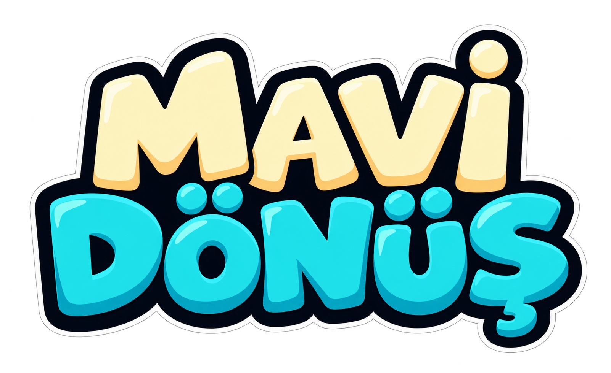
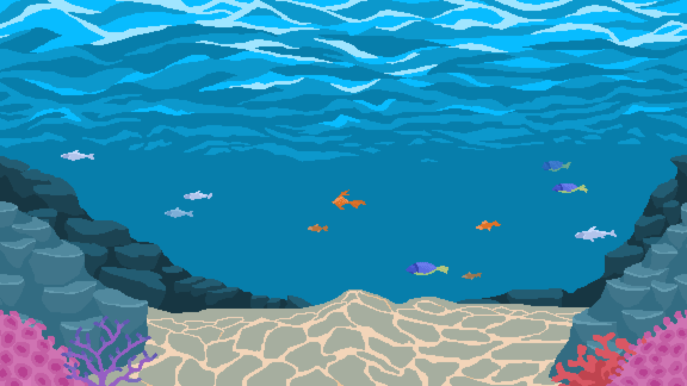
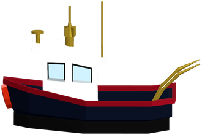
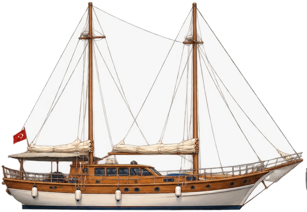
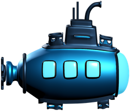

<div align="center">



# 🌊 Mavi Dönüş

### Denizi temizle, yaşamı koru.

**Akdeniz kıyılarından derin sulara uzanan bir çevre koruma yolculuğu.**


[Oynanış](#-oynanış) · [Bölümler](#-beş-bölüm-bir-akdeniz) · [Kurulum](#-projeyi-çalıştırma) · [Kontroller](#-kontroller) · [Yol haritası](#-yol-haritası)



*Oyun dünyasında kullanılan resif arka planı.*

</div>

## 🐢 Oyun hakkında

**Mavi Dönüş**, gemi ve denizaltıyla atık topladığın, Carettaları kurtardığın ve temiz enerjiye geçerek kirliliği azalttığın, tek oyunculu bir 2D oyun.

Fırtınanın kıyıya taşıdığı plastiklerle başlayan görevler; bir kargo gemisi kazasına, hayalet ağlara ve zehirli atıklara uzanıyor. Dalgıç Deniz’in telsiz brifingleriyle Akdeniz’in farklı bölgelerinde temizlik operasyonlarına katılıyorsun.

> **Atıkları toplamak başlangıç. Görev, çöpleri konteynere teslim ettiğinde tamamlanır.**

## 🎮 Oynanış

1. **Görevini öğren.** Bölüm brifingini dinle ve hedeflerini gör.
2. **Denizi temizle.** Aracının toplama alanıyla atıkları al.
3. **Canlıları koru.** Balıklara çarpmadan ilerle; Carettaların yanında kalarak onları kurtar.
4. **Aracını geliştir.** Kazandığın coin’lerle araç ve ekipman satın al.
5. **Konteynere dön.** Taşıdığın tüm atıkları sağ alttaki konteynere bırak.
6. **Sonraki göreve geç.** Tamamlanma ekranından ilerle veya ana sayfaya dön.

### Temizliği yaparken nasıl ilerlediğin de önemli

- Motor emisyonu ve yeni oluşan atıklar, oyun içi kirliliği artırır.
- Balıklara çarpmak kirlilik cezası getirir.
- Güneş paneli veya elektrikli tahrik, motor emisyonunu sıfırlar.
- Son çöp toplandığında kirlilik **%0’da kalır** ve emisyon durur.
- Deniz temizlendikten sonra dönüş ve kalan kurtarma görevleri için sayaç durur.
- Taşınan çöpler teslim edilmeden bölüm tamamlanmaz.
- Kurtarılmayı bekleyen Caretta varsa görev devam eder.
- Son bölümde tüm koşullar tamamlandığında oyun kazanılır.

## 🗺️ Beş bölüm, bir Akdeniz

| Bölüm | Bölge | Görev odağı | Araç türü |
| :---: | --- | --- | --- |
| **01** | Kaleiçi Koyu — Sabah Nöbeti | Plastik ve cam atıklarını temizleme | Gemi / bot |
| **02** | Resif Sığlığı — Kargo Gemisi Kazası | Kazayla yayılan lastikler ve kimyasal atıklar | Gemi / bot |
| **03** | Korsan Koyu — Hayalet Ağlar & Carettalar | Caretta kurtarma ve derin su temizliği | Denizaltı |
| **04** | Derin Kanal — Zehirli Varil Krizi | Zehirli variller ve kimyasal balçık | Denizaltı |
| **05** | Mavi Dönüş — Büyük Akdeniz Zaferi | Son atıkları temizleyerek görevleri tamamlama | Denizaltı |

İlk iki bölümde hareket ve üretim alanları, arka planın deniz yüzeyi çizgisine göre sınırlandırılır. Geminin altındaki **4 piksellik temas şeridi** su çizgisinin altında kalır; üst gövdesi yüzeye çıkabilir.

## ⚓ Tersane & mağaza

<div align="center">


&nbsp;&nbsp;&nbsp;

&nbsp;&nbsp;&nbsp;


</div>

**Ana menüde dört kategori:** Gemiler · Denizaltılar · Gemi Ekipmanları · Dalış Ekipmanları

Her kategori kendi ürünlerini açar. Başlığın solundaki **← Geri** düğmesi kategori listesine döndürür. Ana menüden farklı bölüm türlerinin ürünleri satın alınabilir; araçlar uygun bölümlerde kullanılır.

**Oyun içi mağaza**, duraklatma menüsünden veya `M` tuşuyla açılır. İlk iki bölümde gemi ve tekne ekipmanları; 3–5. bölümlerde denizaltı ve dalış ekipmanları gösterilir. Bölüm sonunda mağaza açılmaz; başarı mesajı, **İleri** ve **Ana Sayfa** seçenekleri görünür.

| Araç | Fiyat |
| --- | ---: |
| Kırmızı Balıkçı Teknesi | Başlangıç aracı |
| Mavi Temizlik Botu | 40 coin |
| Ahşap Akdeniz Guleti | 65 coin |
| Yeşil Eko-Gemi | 85 coin |
| Sahil Güvenlik Botu | 130 coin |
| Keşif Denizaltısı | Ücretsiz başlangıç denizaltısı |
| Mavi Derinlik Denizaltısı | 95 coin |
| Yeşil Eko-Denizaltı | 140 coin |

Üçüncü bölüme geçerken uygun denizaltı otomatik seçilir. Gelişmiş bir denizaltın yoksa ücretsiz Keşif Denizaltısı ile devam edersin.

| Yükseltme | Gemi ekipmanı | Dalış ekipmanı | Fiyat |
| --- | --- | --- | ---: |
| Toplama alanı +25 | Geniş Ağ | Dalgıç Toplama Aparatı | 8 coin |
| Motor emisyonunu sıfırlama | Güneş Paneli | Emisyonsuz Elektrikli Tahrik | 12 coin |

Gemi ve dalış yükseltmeleri ayrı kaydedilir. Satın alınan araçlar, ekipmanlar, coin’ler ve bölüm ilerlemesi sonraki oturumlarda korunur.

## ⌨️ Kontroller

| Tuş / işlem | İşlev |
| --- | --- |
| `W A S D` veya yön tuşları | Hareket |
| `P` / `Esc` | Duraklatma menüsü |
| `M` | Oyun içi tersane ve mağaza |
| `G` | Görevler |
| Atığa yaklaşma | Toplama alanındaki çöpü otomatik alma |
| Caretta’nın yanında 2 saniye kalma | Kurtarma |
| Konteynere yanaşma | Taşınan çöpleri otomatik teslim etme |

## 🌍 COP31 ile kurduğumuz bağ

| Odak | Oyundaki karşılığı |
| --- | --- |
| **Sıfır atık** | Atıkları toplama ve konteynere teslim etme |
| **Döngüsel ekonomi farkındalığı** | Atığın doğru yere ulaştırılmasını ödüllendirme |
| **Temiz enerji dönüşümü** | Güneş paneli ve elektrikli tahrik seçenekleri |
| **Deniz yaşamını koruma** | Caretta kurtarma ve balıklara zarar vermekten kaçınma |
| **İklim eğitimi** | Oyuncunun seçimlerini kirlilik göstergesiyle ilişkilendirme |

Sıfır atık, temiz enerji, döngüsel ekonomi ve eğitim bağlantıları, [COP31 Eylem Gündemi’nde açıklanan önceliklerle](https://unfccc.int/news/cop31-presidency-announces-new-targets-on-global-electrification-cutting-waste-resilient-cities) örtüşür. Oyundaki kirlilik yüzdesi ve emisyon değerleri, oynanış için tasarlanmış göstergelerdir.

## 🚀 Projeyi çalıştırma

**Gereksinim:** Godot 4.7 serisi. Geliştirme ve kontrollerde Godot **4.7.2** kullanıldı.

```bash
git clone https://github.com/tubaiskol/Mavi-Donus-Hackathon-Team22.git
cd Mavi-Donus-Hackathon-Team22
```

1. Godot Project Manager’da **Import** seçeneğini aç.
2. Depodaki `project.godot` dosyasını seç.
3. Varlıkların içe aktarılmasını bekle.
4. **F5** ile oyunu başlat.

Godot terminal komutu sisteminde tanımlıysa:

```bash
godot --editor --path .
```

### Ekran ve platform desteği

- 1280 × 720 temel tasarım boyutu.
- Farklı ekran oranlarına genişleyen oyun alanı.
- Ekranı kaplayan, oranı korunan arka planlar.
- Yeniden boyutlandırmada ortalanan mağaza paneli.
- 4K, ultra geniş, tablet ve telefon ölçülerinde yerleşim kontrolleri.
- Mobilde yatay ekran yönü ayarı.
- Depoda **Web** ve **Linux** dışa aktarma önayarları.

Mobil ekran uyumu mevcut. Dokunmatik hareket kontrolleri ve gerçek mobil cihaz testleri, gelecek geliştirmeler arasında.

## 🧪 Otomatik kontroller

| Kontrol | Kapsam |
| --- | --- |
| `panel_layout_test.gd` | Panel yerleşimi, konteynere yanaşma ve güvenli üretim alanları |
| `level_environment_test.gd` | Bölüm sınırları, araçlar, canlı hareketleri ve temiz deniz emisyonu |
| `shop_progression_test.gd` | Kategoriler, fiyatlandırmada kullanılan satın alma akışı, ekipman ve kayıt/yükleme |
| `responsive_layout_test.gd` | Sekiz ekran boyutunda menü, arka plan, HUD ve mağaza yerleşimi |
| `delivery_completion_test.gd` | Teslimat bekleme, süre sınırı, kazanma ve kaybetme ekranları |

<details>
<summary><strong>Windows / PowerShell: oyuncu kaydını etkilemeden testleri çalıştır</strong></summary>

Godot çalıştırılabilir dosyasının `godot` adıyla PATH üzerinde bulunması gerekir. Aşağıdaki komutları proje klasöründe çalıştır:

```powershell
$previousAppData = $env:APPDATA
try {
    foreach ($test in Get-ChildItem tests/*_test.gd) {
        $env:APPDATA = Join-Path (Get-Location).Path ".godot/test-users/$($test.BaseName)"
        New-Item -ItemType Directory -Force -Path $env:APPDATA | Out-Null
        godot --headless --path . --script "res://tests/$($test.Name)"
        if ($LASTEXITCODE -ne 0) { throw "Test başarısız: $($test.Name)" }
    }
} finally {
    $env:APPDATA = $previousAppData
}
```

Testler satın alma ve ilerleme verilerini değiştirebildiği için her test ayrı bir kayıt klasöründe çalıştırılır. Projeyi önce Godot editöründe açarak varlıkların içe aktarılmasını tamamla.

</details>

## 🛠️ Proje yapısı

```text
assets/                 Görseller, araçlar, arka planlar ve sesler
scenes/                 Ana menü, oyun, araç ve canlı sahneleri
scripts/
  game.gd               Bölüm akışı, teslimat ve sonuç ekranları
  game_state.gd         Coin, envanter, görevler ve kayıt sistemi
  boat.gd               Oyuncu aracı ve hareket
  hud.gd                İstatistikler ve görev arayüzü
  shop.gd               Oyun içi mağaza ve bölüm tamamlanma paneli
  main_menu.gd          Ana menü ve dört kategorili mağaza
  level_environment.gd  Bölüm arka planları ve deniz yüzeyi sınırları
  panel_layout.gd       Sağ alt panellerin ortak yerleşimi
tests/                  Otomatik oyun akışı ve yerleşim kontrolleri
project.godot           Godot proje ayarları
export_presets.cfg      Dışa aktarma önayarları
```

## 🧭 Yol haritası

Gelecek geliştirmeler için hedefler:

- [ ] Oyuncu geri bildirimleriyle zorluk ve ekonomi dengesi.
- [ ] Mobil dokunmatik hareket kontrolleri.
- [ ] Gerçek telefon ve tabletlerde performans testleri.
- [ ] Atık ayrıştırma ve geri dönüşüm görevleri.
- [ ] Yeni deniz bölgeleri ve canlı türleri.
- [ ] Eğitim odaklı pilot çalışmalar ve farkındalık değerlendirmeleri.

---

<div align="center">

**Derin Etki Takımı · Mavi Dönüş**

*Temizlik bir tur, dönüşüm bir karar.*

[🐛 Hata bildir / fikir paylaş](https://github.com/tubaiskol/Mavi-Donus-Hackathon-Team22/issues)

</div>
